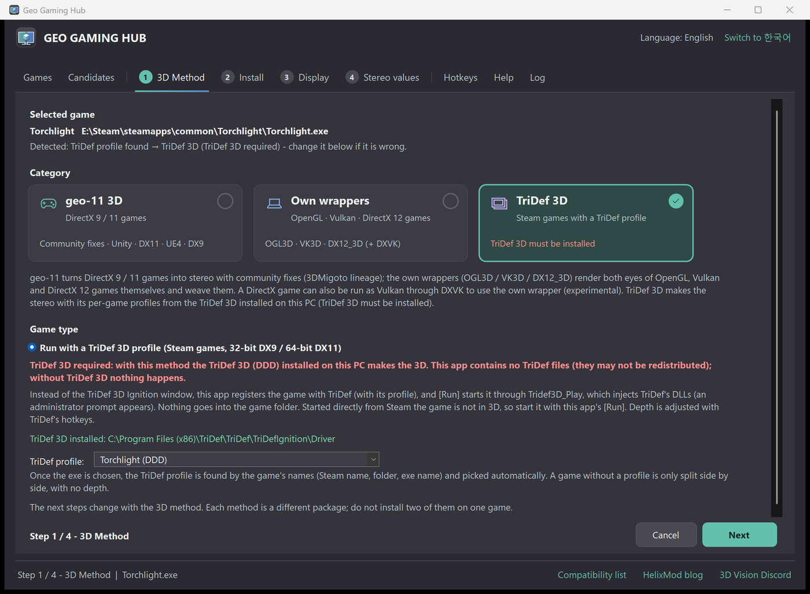

# Geo Gaming Hub

[English](README.md) · **한국어**

PC 게임에 입체 3D를 설치하는 통합 앱입니다. 게임 실행 파일을 고르면 맞는 3D 방식을 골라 게임 폴더에 넣고 설정합니다.
SR 디스플레이(Acer SpatialLabs / Leia SR)에서는 SR 위빙, 3D TV나 그 밖의 모니터에서는 Side-by-Side / Top-and-Bottom으로 출력합니다.

| 게임 | 방식 |
|---|---|
| Unity, DirectX 11, Unreal Engine 4, DirectX 9 | geo-11 (+ Unity / UE4 Universal Fix, DX9는 dgVoodoo2) + SRWeave |
| OpenGL | [OGL3D](https://github.com/nautymac/OGL3D-SR) |
| Vulkan | VK3D |
| DirectX 12 | DX12_3D |
| TriDef 3D 프로필이 있는 게임 | 설치된 TriDef 3D + Tridef3D_Play (TriDef 3D 설치 필수) |

사용법, 단축키, 들어 있는 패키지와 라이선스는 [release/README.ko.md](release/README.ko.md)에 있습니다.

## 저장소

| 경로 | 내용 |
|---|---|
| `src\` | 앱 소스 (C# WinForms, .NET Framework 4.x); `src\build.cmd` → `GeoGamingHub.exe` |
| `tests\` | `HubTest.exe` 자체 시험 (unit, gui, vkunit, vkgui, cand, dx12unit, dx12gui, tri, pkg) |
| `data\` | 후보 목록 데이터, TriDef 프로필 이름 |
| `tools\library_survey\` | 후보 목록을 만드는 스크립트 (PCGamingWiki) |
| `tools\icon\make_icon.py` | 아이콘(`src\app.ico`) 생성 |
| `.github\` | 게임 보고 양식 |

설치 패키지(`Packages\`: geo-11, OGL3D, VK3D, DX12_3D, DXVK, TriDef 실행기)는 저장소에 없고 배포 zip에 들어 있습니다.
`GeoGamingHub.exe` 옆에 `Packages\`가 있어야 합니다.
